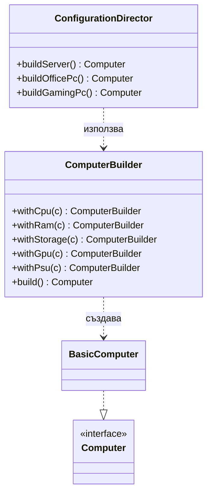
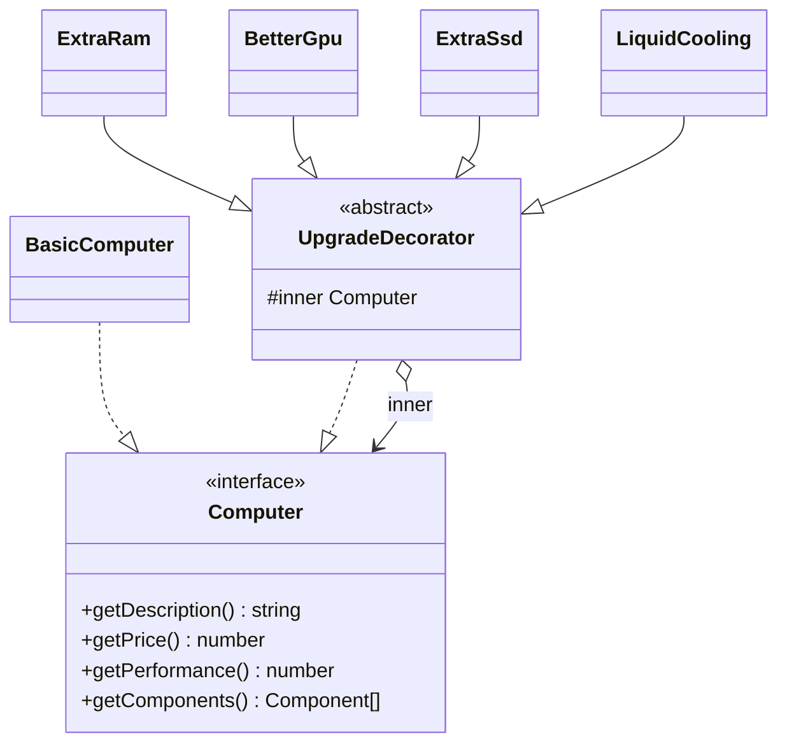
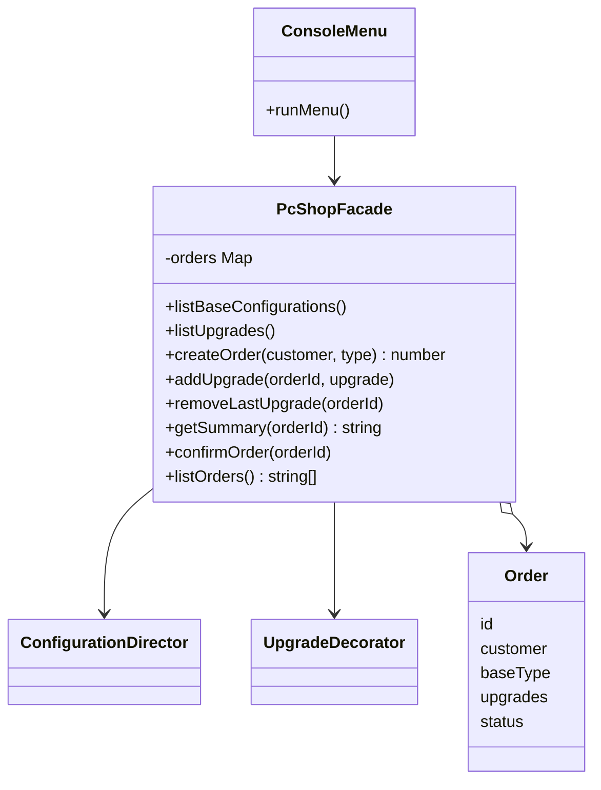
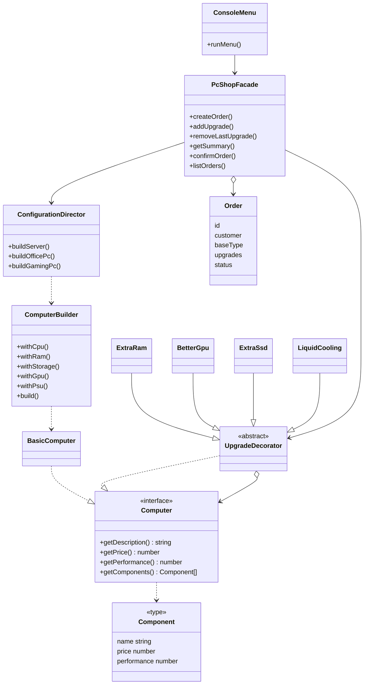
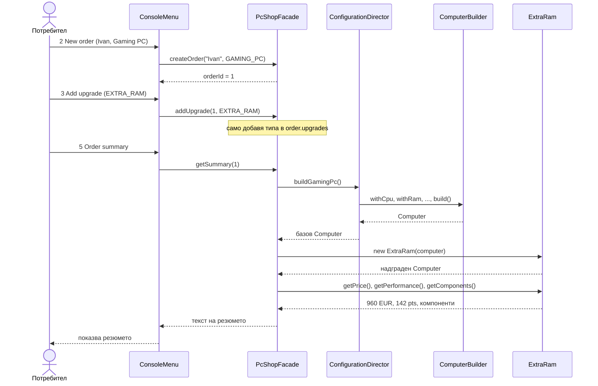

# Поръчка на компютърни конфигурации – документация

Курсов проект по „Софтуерни шаблони“. Използвани шаблони: **Builder**, **Decorator**, **Façade**.

## 1. Описание и стартиране

Конзолна програма за поръчка на компютри. Има три базови конфигурации (Server, Office PC, Gaming PC). Клиентът поръчва една от тях и може да я надгради с допълнителни компоненти (Extra RAM, Better GPU, Extra SSD, Liquid cooling). Програмата изчислява цената (в цели евро) и производителността (в точки) на крайната конфигурация.

Изисквания: Node.js 20+.

```bash
npm install     # инсталира typescript, tsx и @types/node
npm start       # стартира конзолното меню
npm test        # пуска тестовете (node:test)
npm run build   # компилира с tsc в папка dist
```

## 2. Структура

```
src/
  model/Computer.ts                  интерфейс Computer
  model/Component.ts                 тип Component
  builder/ComputerBuilder.ts         Builder
  builder/ConfigurationDirector.ts   Director (3-те базови конфигурации)
  decorator/UpgradeDecorator.ts      абстрактен декоратор
  decorator/upgrades.ts              4 конкретни декоратора + applyUpgrade()
  facade/PcShopFacade.ts             Façade
  order/Order.ts                     поръчка
  ui/consoleMenu.ts                  конзолно меню
  index.ts                           входна точка
test/
  builder.test.ts  decorator.test.ts  facade.test.ts
```

## 3. Описание на файловете и класовете

| Файл | Отговорност | Основни методи |
|---|---|---|
| `model/Component.ts` | Тип за една част: `name`, `price` (EUR), `performance` (точки). | – |
| `model/Computer.ts` | Общ интерфейс за базов компютър и за всяко надграждане. | `getDescription()`, `getPrice()`, `getPerformance()`, `getComponents()` |
| `builder/ComputerBuilder.ts` | Сглобява компютър стъпка по стъпка. Вътрешният клас `BasicComputer` държи списъка с компоненти и сумира цената и производителността. | `withCpu()`, `withRam()`, `withStorage()`, `withGpu()`, `withPsu()`, `build()` – хвърля грешка, ако липсва CPU, RAM или storage |
| `builder/ConfigurationDirector.ts` | Знае „рецептата“ за всяка базова конфигурация. | `buildServer()`, `buildOfficePc()`, `buildGamingPc()` |
| `decorator/UpgradeDecorator.ts` | Абстрактен клас, който обвива `Computer` и добавя към него един компонент. | `getPrice()`, `getPerformance()`, `getComponents()`, `getDescription()` |
| `decorator/upgrades.ts` | Конкретните декоратори `ExtraRam`, `BetterGpu`, `ExtraSsd`, `LiquidCooling` (всеки само задава своя компонент) и функцията `applyUpgrade(computer, type)`. | `applyUpgrade()` |
| `order/Order.ts` | Поръчка: `id`, `customer`, `baseType`, `upgrades` (списък с типове), `status` (`DRAFT`/`CONFIRMED`). Не държи `Computer` обект. | – |
| `facade/PcShopFacade.ts` | Единствената точка за достъп за UI. Пази поръчките в `Map` в паметта и сглобява `Computer` веригата при нужда. | `listBaseConfigurations()`, `listUpgrades()`, `createOrder()`, `addUpgrade()`, `removeLastUpgrade()`, `getSummary()`, `confirmOrder()`, `listOrders()` |
| `ui/consoleMenu.ts` | Конзолно меню с `node:readline/promises`. Грешките се ловят и се показват като съобщение, програмата не спира. | `runMenu()` |
| `index.ts` | Входна точка – вика `runMenu()`. | – |

**Защо `Order` пази само типа и списъка с надграждания?** Веригата от декоратори се сглобява наново при всяко `getSummary()`. Така `removeLastUpgrade()` е просто `pop()` на масив – не е нужно да „разопаковаме“ декораторите.

## 4. Шаблоните

### 4.1 Builder

**Проблем:** Компютърът се състои от много части, някои задължителни (CPU, RAM, storage), други по избор (GPU, PSU). Конструктор с 5 параметъра би бил нечетлив, а трите конфигурации се различават само по частите.

**Решение:** `ComputerBuilder` с fluent методи `withXxx()` и `build()`, който проверява задължителните части. `ConfigurationDirector` съдържа готовите рецепти.

| GoF роля | Клас |
|---|---|
| Builder / ConcreteBuilder | `ComputerBuilder` |
| Director | `ConfigurationDirector` |
| Product | `BasicComputer` (през интерфейса `Computer`) |



### 4.2 Decorator

**Проблем:** Надграждането трябва да може да се прилага в произволен брой и ред, включително един и същ ъпгрейд два пъти. Подклас за всяка комбинация би дал експлозия от класове.

**Решение:** Всеки ъпгрейд е обвивка около `Computer`, която добавя своя компонент към цената, производителността и списъка с компоненти. Обвивката сама е `Computer`, така че може да се обвие отново.

| GoF роля | Клас |
|---|---|
| Component | `Computer` |
| ConcreteComponent | `BasicComputer` |
| Decorator | `UpgradeDecorator` |
| ConcreteDecorator | `ExtraRam`, `BetterGpu`, `ExtraSsd`, `LiquidCooling` |



Пример: `new LiquidCooling(new ExtraRam(officePc))` – цената е цената на Office PC + 70 + 120.

### 4.3 Façade

**Проблем:** За една поръчка UI-то иначе трябва да знае за директора, билдъра, декораторите, `Order` и `Map`-а с поръчки.

**Решение:** `PcShopFacade` предлага 8 прости метода. UI-то вижда само него. Фасадата проверява и правилото, че потвърдена поръчка не може да се променя.

| GoF роля | Клас |
|---|---|
| Facade | `PcShopFacade` |
| Подсистеми | `ConfigurationDirector`, `ComputerBuilder`, `UpgradeDecorator` и наследниците, `Order` |
| Client | `consoleMenu` (`runMenu`) |



## 5. Обща диаграма на класовете



## 6. Диаграма на последователността: създаване на поръчка с надграждане



## 7. Примерен изход от реално пускане

Входът е подаден през pipe, затова програмата отпечатва и въведеното. Менюто е съкратено – показани са само отговорите.
Сценарий: преглед на конфигурациите → нова поръчка (Gaming PC) → Extra RAM, Liquid cooling, Extra RAM → премахване на последното → резюме → потвърждаване → опит за промяна (грешка) → списък с поръчки.

```text
Select: 1
SERVER - 1700 EUR, 100 pts
OFFICE_PC - 200 EUR, 38 pts
GAMING_PC - 890 EUR, 130 pts
Select: 2
Customer name: Ivan
Base configuration:
Choice: 3
Created order #1
Select: 3
Order id: 1
Upgrade:
Choice: 1
Upgrade added.
Select: 3
Order id: 1
Upgrade:
Choice: 4
Upgrade added.
Select: 3
Order id: 1
Upgrade:
Choice: 1
Upgrade added.
Select: 4
Order id: 1
Last upgrade removed.
Select: 5
Order id: 1
Order #1 (DRAFT) for Ivan
Gaming PC + Extra 16GB RAM + Liquid cooling
  - Core i7 CPU: 350 EUR, 45 pts
  - 16GB RAM: 70 EUR, 15 pts
  - 1TB NVMe SSD: 90 EUR, 20 pts
  - RTX 4060 GPU: 300 EUR, 50 pts
  - 650W PSU: 80 EUR, 0 pts
  - Extra 16GB RAM: 70 EUR, 12 pts
  - Liquid cooling: 120 EUR, 10 pts
Total price: 1080 EUR
Total performance: 152 pts
Select: 6
Order id: 1
Order confirmed.
Select: 3
Order id: 1
Upgrade:
Choice: 2
Error: Order #1 is confirmed and cannot be changed
Select: 7
#1 Ivan - GAMING_PC - 1080 EUR - CONFIRMED
Select: 0
Goodbye!
```
